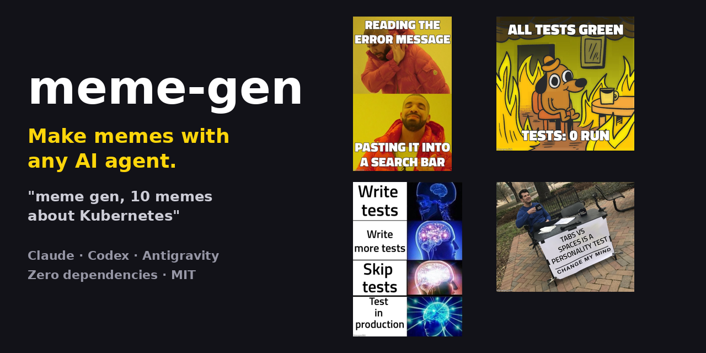
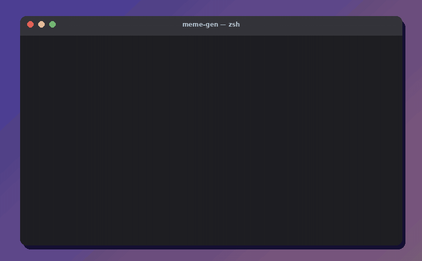
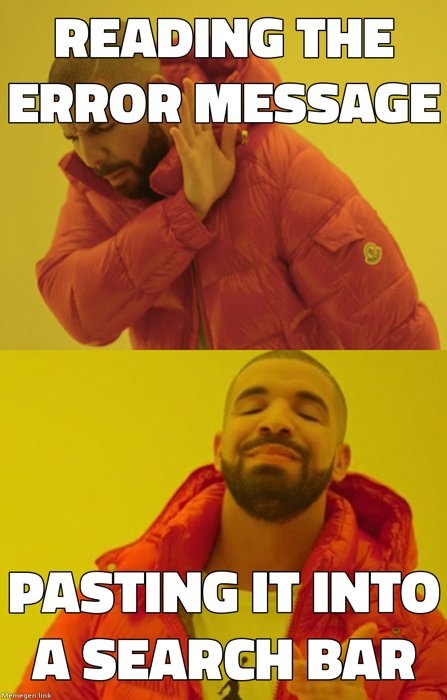
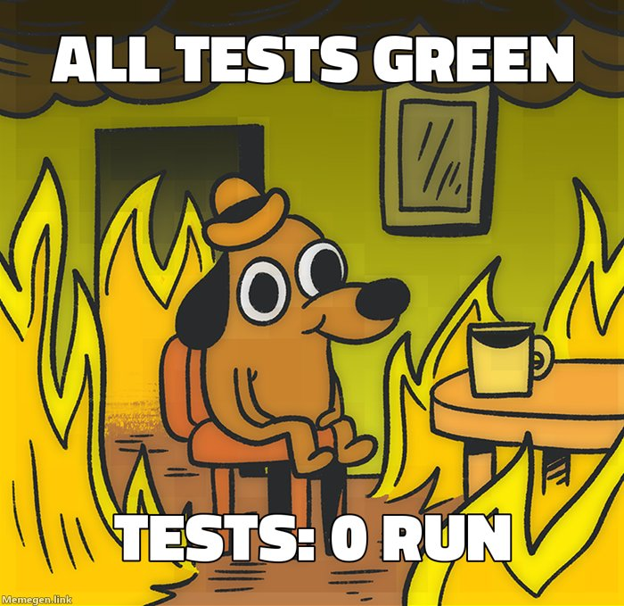
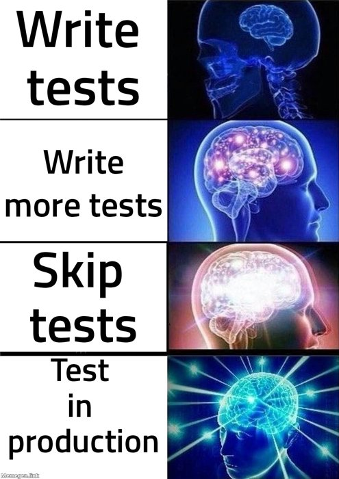
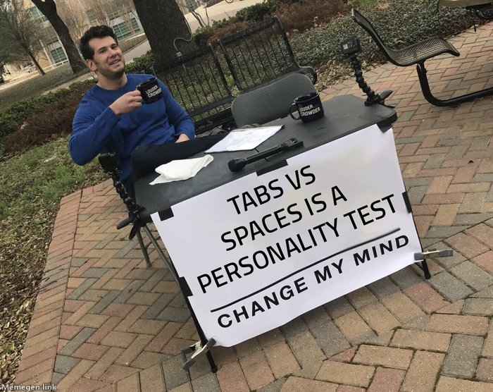

<p align="center"></p>

# meme-gen: AI meme generator skill for Claude, Codex, Antigravity and any coding agent

[](https://github.com/Ruhanyat-994/meme-gen-skill/actions)
[](LICENSE)


<p align="center"><br><sub>Demo animation of the workflow. The memes shown are real meme-gen output.</sub></p>

**Say "meme gen, 10 memes about Kubernetes" to your AI agent and get finished, funny meme images in your folder in about a minute.** A free, open-source Agent Skill (`SKILL.md`) plus a zero-dependency Python CLI. No API key, no image-model credits.

<p align="center">
   
</p>

*Made with one prompt, no editing.*

**Why people use it:** meme generator for developers and content creators, AI agent skill that works across tools, batch meme maker for social media, trending-news memes, caption your own images, a contact sheet to check every meme before posting, and a `captions.csv` ready for your scheduler.

- Works as an [Agent Skill](https://agentskills.io) (SKILL.md) for Claude, Codex, Antigravity and other agents, plus a plain `AGENTS.md` for everything else.
- Zero dependencies: one Python 3.8+ script using only the standard library. Pillow is optional (contact sheets, captioning your own local images).
- Modes: **topic memes**, **trending-news memes** (if your agent has web search), **your own image + text**, a **visual check sheet**, and a **captions.csv** for posting later.
- Images are rendered by the free, open-source [memegen.link](https://memegen.link) service. No AI image model, no API key.

## Install

```bash
git clone https://github.com/Ruhanyat-994/meme-gen-skill.git
cd meme-gen-skill
python install.py --target all          # copies the skill into your home folder
# or only one tool:  --target claude | agents | gemini
# or just this project: python install.py --target all --project
```

| Tool | Skill location |
|---|---|
| Claude (Code / Cowork / desktop) | `~/.claude/skills/meme-gen` or `<project>/.claude/skills/meme-gen` |
| Codex | `~/.agents/skills/meme-gen` or `<project>/.agents/skills/meme-gen` |
| Antigravity | `<project>/.agents/skills/meme-gen` or `~/.gemini/config/skills/meme-gen` |
| Other agents | Copy `AGENTS.md` and the `skills/meme-gen` folder into your project |

Skill folder locations differ between tool versions; if yours differs, copy `skills/meme-gen` wherever your tool loads skills from.

**ChatGPT (web/app):** a chat window cannot write files to your computer, so use ChatGPT's agent/Codex features, or paste `skills/meme-gen/SKILL.md` into the chat and run the CLI yourself. Skill-upload support varies by plan; check your current ChatGPT settings.

## Allow the network (important)

The CLI needs HTTPS access to **`api.memegen.link`**. In sandboxed tools (cloud agents, some desktop apps) add that domain to the allowed domains in the tool's network settings. Check it with:

```bash
python skills/meme-gen/scripts/meme_gen.py doctor
```

## Use it

In your AI tool, from the folder where you want the memes:

```
meme gen: 10 memes about DevOps
meme gen: 5 memes from today's AI news
meme gen: put "when the build passes" and "on the first try" on photo.jpg
```

Memes land in `./memes/` with `captions.csv`, `manifest.json` and a `_check/` folder of contact sheets.

## CLI

```bash
python skills/meme-gen/scripts/meme_gen.py templates drake            # curated list, offline
python skills/meme-gen/scripts/meme_gen.py render --template drake --text "Reading docs" "Guessing"
python skills/meme-gen/scripts/meme_gen.py batch examples/memes.json
python skills/meme-gen/scripts/meme_gen.py check memes
python skills/meme-gen/scripts/meme_gen.py custom --image photo.jpg --top "top text" --bottom "bottom text"
python skills/meme-gen/scripts/meme_gen.py templates --live linux     # search all memegen templates
```

Batch file format: `[{"template":"drake","text":["rejected","preferred"],"caption":"","hashtags":["#dev"]}]`.
Set `MEME_GEN_BASE_URL` to use a self-hosted memegen instance (https only).

## Safety

Safe-content defaults, a host allowlist, size limits and image validation are documented in [`skills/meme-gen/references/safety.md`](skills/meme-gen/references/safety.md). Caption text is sent to memegen.link; do not put secrets in captions.

## Develop

```bash
python -m unittest discover -s tests -v
```

## Credits

meme-gen is a thin, independent skill built on top of **[memegen](https://github.com/jacebrowning/memegen)** by Jace Browning and contributors (MIT), the free and open-source API behind [memegen.link](https://memegen.link). All meme images and templates are rendered by that service; this project only adds the agent workflow around it. Please [support memegen](https://github.com/jacebrowning/memegen) and keep its watermark/credit when you share memes. This project is not affiliated with or endorsed by memegen.

## License

MIT, see [LICENSE](LICENSE). Third-party notices are in [THIRD_PARTY.md](THIRD_PARTY.md).

## FAQ

**Is this an AI image generator?** No. Memes use real, recognisable meme templates and your agent writes the jokes, so text is always sharp and readable.

**Does it cost anything?** No. MIT licensed, no API key.

**Which AI tools work?** Any agent that supports Agent Skills or reads `AGENTS.md`: Claude, Codex, Antigravity and similar.

**Can I post the memes?** Yes, they are normal PNG files plus `captions.csv`. Keep the memegen.link credit.

## Contributing

New joke shapes, templates and tool install notes are welcome. Run the tests, then open a pull request.

<sub>Keywords: meme generator, AI meme generator, meme maker, agent skill, SKILL.md, Claude skill, Codex skill, Antigravity skill, programming memes, developer memes, tech memes, social media content, memegen.</sub>
